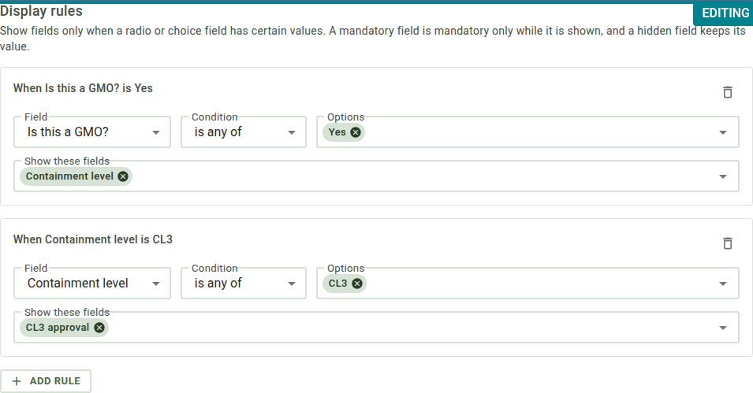
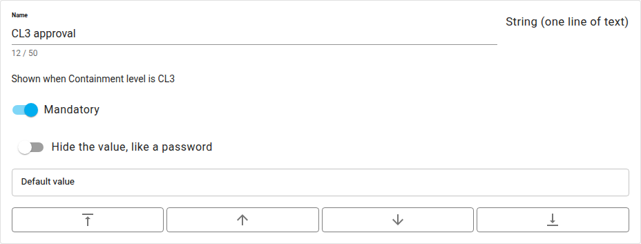
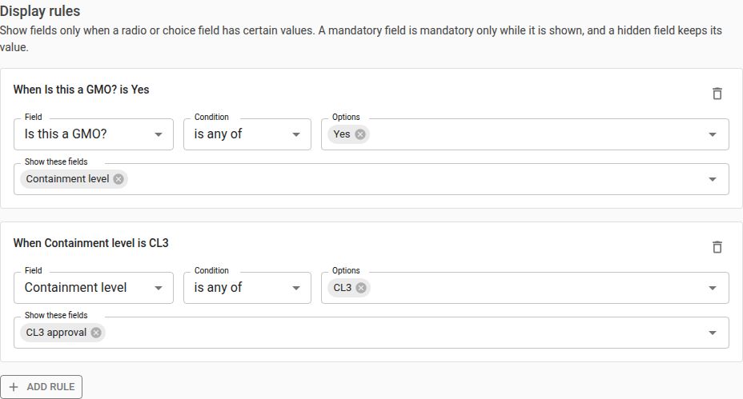

# Showing fields only when they apply (display rules)

This guide is the user documentation for conditional field display in ELN Forms and in
Inventory sample and instrument templates. User help is published on
[documentation.researchspace.com](https://documentation.researchspace.com); this page is the
source text for two articles there, one in the ELN Forms section and one in the Inventory
templates section. Each part below says which article it belongs to.

## What display rules do

A display rule shows a field only when a radio or choice field in the same form or template has
(or lacks) certain answers. For example, "GMO permit number" can be shown only when "Is this a
GMO?" is "Yes".

- A rule reads one radio or choice field, its **source**. Rules cannot read other field types.
- A field can have at most one rule. One rule can show several fields.
- Conditions:
  - **is any of** the chosen options. For a choice field, at least one selected option is in the
    list.
  - **is none of** the chosen options, which is also true when nothing is selected.
  - **has a value**: any option is selected.
  - **has no value**: nothing is selected.
- If the source field is itself hidden, every field that depends on it is hidden too, whatever
  the condition. Rules can therefore form chains: "GMO?" shows "Containment level", and
  "Containment level" = CL3 shows "CL3 approval".
- A field cannot depend on itself, directly or through other fields. The editor does not offer
  such a choice.
- Hiding is about presentation, not access. A hidden field keeps its value, and that value is
  still in exports and in the API.

## Writing rules

The ELN form editor and the Inventory template editor work the same way. Both edit in memory
and save once, so you can add a field and use it in a rule before you save.

### The Display rules panel

The **Display rules** panel sits above the list of fields. Each rule reads "When [field] is
[options]", followed by the fields it shows.

1. Add at least one radio or choice field. Until there is one, the panel says so.
2. Select **Add rule**.
3. Choose the **Field** the rule reads, the **Condition** and, for "is any of" and "is none of",
   the **Options**.
4. In **Show these fields**, choose the fields to show when the condition is true. The list
   leaves out fields that would make a loop.
5. Save the form or template.

To change a rule, edit it in the panel. To remove it, use its delete button; the fields it
showed are then always shown. Fields that have identical rules are listed together under one
rule.

A rule that is not finished (for example, no options chosen yet) stays in the panel with a
warning and is not applied. If you were editing a saved rule, the saved rule stays as it was
until your change is complete.

### The "Shown when..." summary

Each field with a rule shows a one-line summary in the field list, for example "Shown when Is
this a GMO? is Yes". If a field sits above the field its rule reads, the summary suggests
moving it below, which reads better for the person filling it in. Order is otherwise up to you.

### When a change affects rules

The editor asks before a change that would break a rule, and names the fields affected:

- **Deleting a field that rules read.** On confirm, the rules of the dependent fields are
  removed, so those fields are always shown.
- **Removing an option that a rule uses.** On confirm, the option is removed from those rules,
  and a rule left with no options is removed.
- **Changing the type of an unsaved radio or choice field** to a type a rule cannot read. On
  confirm, the dependent rules are removed.

An option that a rule uses cannot be edited in place, so typing cannot quietly break a rule. To
rename it, add the new option, update the rule, then remove the old option.

### ELN Forms: the form editor

Use this part for the ELN Forms article.

- The field editor is built into the form page. Add fields with **Add field**; reorder them with
  the move buttons on each field. There is no separate "Reorder Fields" dialog any more.
- Save with the toolbar as before. **Save and Close**, **Update** and **Publish** save the
  fields first. If a field has a problem, nothing is saved, the problem is marked on the field,
  and the editor stays open. **Revert** asks before it discards your changes.
- If you leave the page with unsaved field changes, the browser asks you to confirm.
- On a published form, fields copied from the published version cannot be deleted, and a saved
  field cannot change type. Fields you add in the new version can.
- Uri, Reference and Attachment fields can only be created through the API. In the editor you
  can rename, reorder, delete them, make them mandatory and use them as the fields a rule
  shows.
- Uploading radio options from a file is not available in this editor yet (RSDEV-1712). Type
  or paste the options instead.

### Inventory: sample and instrument templates

Use this part for the Inventory templates article.

- The Display rules panel is in the template's fields section, for both sample templates and
  instrument templates.
- Rules apply to template fields only. Extra fields (the fields you add to a single sample,
  subsample, container or instrument) cannot have rules and are always shown.
- When you duplicate a template, its rules come with it and still point at the right fields.

## Filling in documents, samples and instruments

- Fields appear and disappear as soon as you change the answer, without reloading the page.
- **Hidden values are kept.** If you type into a field and then change the answer so the field
  is hidden, the value is not cleared. It comes back when the field is shown again, and it is
  saved even while hidden.
- **Mandatory applies only while shown.**
  - Inventory: a hidden mandatory field never blocks saving. A shown, empty mandatory field does,
    as before. For samples the Save button is disabled; for instruments the check is made when
    you save. One exception, also as before: an instrument's Landing page may be left blank when
    you create the instrument, even if the template makes it mandatory.
  - ELN: a hidden mandatory field does not stop the document from being signed and does not
    raise the workspace warning. A shown, empty mandatory field still disables **Sign**, as
    before. Saving a document is never blocked by mandatory fields.
- In view mode, hidden fields are not shown. This applies to ELN document view, notebooks and
  public (published) documents and notebooks, and to Inventory sample, subsample and instrument
  views. A subsample shows its sample's template fields read-only, with the same rules applied.
- Exports and the API include every field and value, shown or hidden: ELN PDF, Word, HTML and
  XML exports, and Inventory CSV export.

### ELN form versions

Documents stay on the form version they were created from. Adding or changing a rule makes a
new version of the form when you **Update** it, and only documents created from that version
use the new rules. Existing documents look and behave exactly as before.

Rules are kept when a published form is edited into a new version, when a form is copied, and
when a form travels in an XML archive export and import.

### Document templates

A document template is a document, so it shows and hides fields in the same way. A document
created from a template starts with the template's answers, and therefore with the same fields
shown. If you leave the source field unanswered when saving a template, its dependent fields
are shown or hidden as for any unanswered source, even when the template stores values for them.

### Inventory: updating to the latest template version

A sample or instrument keeps its own copy of the template's fields and rules. When a template
author adds or changes a rule, existing samples and instruments do not change until their owner
updates them to the latest template version. The update copies the template's current rules.

As before, fields newly added to the template may stay empty after the update even if they are
mandatory. Only an existing field that becomes mandatory can stop the update, and now only if
that field is shown after the update.

### Revisions and earlier versions

Earlier revisions of an ELN document, and earlier versions of an Inventory sample or instrument,
show and hide fields by the rules they had and the answers saved in that revision or version. An
earlier template version shows every field, with the rule summaries it had. An ELN document takes its rules from the form version it was created from. Revisions
and versions saved before any rule existed, including everything from before the upgrade, have
no rules, so they show every field.

### Accessibility

- Hidden fields are removed from the tab order and from what screen readers read out.
- When an answer reveals fields, keyboard focus stays on the control you changed, and screen
  readers announce the newly shown fields, for example "2 more fields are shown: Containment
  level and CL3 approval". The announcement is polite, so it does not interrupt.
- Everything in the Display rules panel, including choosing options and fields, works with the
  keyboard. Each field's move and delete buttons name the field they act on.

## Known limitations

This list matches the published limitations in "Known limitations of conditional field display"
in the release notes ([Changelog-OS.md](Changelog-OS.md)).

- Uploading radio options from a file is not yet available in the new ELN form field editor
  (RSDEV-1712).
- Inventory CSV export and import do not carry display rules.
- Hidden fields keep their values, which remain in exports (ELN PDF, Word, HTML and XML;
  Inventory CSV) and in API responses.
- Inventory extra fields cannot have display rules.
- ELN form versions created before the upgrade do not share field keys with each other. This is
  harmless today, because rules are only ever read within one form version.
