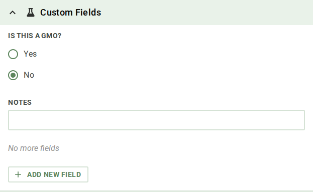
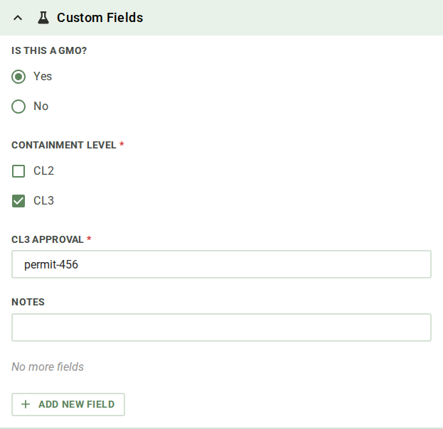

# Showing fields only when they apply (display rules)

This guide is the user documentation for conditional field display in ELN Forms and in
Inventory sample and instrument templates. User help is published on
[documentation.researchspace.com](https://documentation.researchspace.com); this page is the
source text for two articles there, one in the ELN Forms section and one in the Inventory
templates section. Each part below says which article it belongs to.

## What display rules do

A display rule shows a field only when a radio or choice field in the same form or template has
(or lacks) certain answers. For example, "GMO permit number" can be shown only when "Is this a
GMO?" is "Yes".

- A rule reads one radio or choice field, its **source**. Rules cannot read other field types.
- A field can have at most one rule. Several fields can have rules that read the same source.
- Conditions:
  - **is any of** the chosen options. For a choice field, at least one selected option is in the
    list.
  - **is none of** the chosen options, which is also true when nothing is selected.
  - **has a value**: any option is selected.
  - **has no value**: nothing is selected.
- If the source field is itself hidden, every field that depends on it is hidden too, whatever
  the condition. Rules can therefore form chains: "GMO?" shows "Containment level", and
  "Containment level" = CL3 shows "CL3 approval".
- A field cannot depend on itself, directly or through other fields. The editor does not offer
  such a choice.
- Hiding is about presentation, not access. A hidden field keeps its value, and that value is
  still in exports and in the API.

## Writing rules

The ELN form editor and the Inventory template editor work the same way. Both edit in memory
and save once, so you can add a field and use it in a rule before you save. A short note above
the fields explains that a mandatory field is mandatory only while it is shown, and that a
hidden field keeps its value.

### "Display this field when…"

Each field's card has a **Display this field when…** section. It offers two choices:

- **Always**: the field has no rule and is always shown. This is the default.
- **Only when another field has certain values**: the field has a rule.

To give a field a rule:

1. In the field's card, choose **Only when another field has certain values**.
2. Choose the **Field** the rule reads. The list offers only the other radio and choice fields,
   and leaves out fields that would make a loop. The first of them is chosen for you.
3. Choose the **Condition**. For "is any of" and "is none of", also choose the **Options**.
4. Save the form or template.

If there is no field the rule could read yet, for example because the form has no other radio or
choice field, the **Field** list shows a disabled "No other fields" item, and the same text
appears below the list. Add a radio or choice field first, or choose **Always**.

The condition is applied as soon as it is complete. Until then, the missing part is marked in
the card:

- "Choose a field." when no field is chosen.
- "Choose at least one option." when "is any of" or "is none of" has no options.
- "This condition cannot be applied. Choose fewer or shorter options." when the condition is
  complete but too large to store (more than 1,000 options, or too long altogether).

Meanwhile the field keeps the rule it had when you started, or stays always shown if it had
none, and the form or template cannot be saved. Finish the condition or choose **Always**, then
save again. See the ELN and Inventory parts below for what Save says.

To remove a rule, choose **Always**; the field is then always shown. If you switch back to
**Only when another field has certain values** before you save, the condition you had comes
back.

The card of a field that rules read lists the fields that depend on it, for example "Other
fields depend on this field: Containment level, CL3 approval".

### The "Shown when..." summary

When the form or template is not being edited, each field with a rule shows a one-line summary
instead of the editor, for example "Shown when Is this a GMO? is Yes". If a field sits above
the field its rule reads, the summary, and the **Field** choice while editing, suggest moving it
below, which reads better for the person filling it in. Order is otherwise up to you.

### When a change affects rules

The editor asks before a change that would break a rule, and names the fields affected:

- **Deleting a field that rules read.** On confirm, the rules of the dependent fields are
  removed, so those fields are always shown.
- **Removing an option that a rule uses.** On confirm, the option is removed from those rules,
  and a rule left with no options is removed.
- **Changing the type of an unsaved radio or choice field** to a type a rule cannot read. On
  confirm, the dependent rules are removed.

An option that a rule uses cannot be edited in place, so typing cannot quietly break a rule. The
option says "A display rule uses this option, so it cannot be renamed." To rename it, add the
new option, update the rule, then remove the old option. In Inventory templates, saved options
cannot be renamed anyway, so the message appears only on an option added in the current edit.

### ELN Forms: the form editor

Use this part for the ELN Forms article.

- The field editor is built into the form page. Add fields with **Add field**; reorder them with
  the move buttons on each field. There is no separate "Reorder Fields" dialog any more.
- Save with the toolbar as before. **Save and Close**, **Update** and **Publish** save the
  fields first. If a field has a problem, nothing is saved, the problem is marked on the field,
  and the editor stays open. **Revert** asks before it discards your changes.
- While a display condition is unfinished, **Save and Close**, **Update** and **Publish** do
  nothing, even if no other field changed. The editor's error alert says "Fix the problems
  marked below, then save again." and "Complete the display condition of {field}, or choose
  Always, before saving.", naming the field, and moves focus to the condition.
- If you leave the page with unsaved field changes, the browser asks you to confirm.
- If the form's fields were saved somewhere else (for example in another tab) after this page
  loaded or saved them, your field changes are not saved, so they cannot overwrite the other
  changes. **Save and Close**, **Update** and **Publish** check this even when you changed
  nothing, and **Update** and **Publish** check it again as they make the version, so they never
  publish or update fields you have not seen. None of them goes ahead. The editor says "This
  form was changed elsewhere." and "Its fields were saved in another tab or window after this
  page loaded them, so nothing was saved from this page. Reload to see the latest fields, then
  make your changes again.", and offers **Reload**.
  If the page has changes that were not saved, it also says "The changes you made on this page
  that were not saved will be lost when you reload."
- If another change to the same form was being saved at the same moment, the database may
  refuse one of them. Nothing is saved, and the error says to try again. This is not treated as
  a change made elsewhere, so you do not need to reload.
- On a published form, fields copied from the published version cannot be deleted, and a saved
  field cannot change type. Fields you add in the new version can.
- Uri, Reference and Attachment fields can only be created through the API. In the editor you
  can rename, reorder, delete them, make them mandatory and use them as the fields a rule
  shows.
- Uploading radio options from a file is not available in this editor yet (RSDEV-1712). Type
  or paste the options instead.

### Inventory: sample and instrument templates

Use this part for the Inventory templates article.

- Each field in the template's fields section has its own **Display this field when…** section,
  in both sample templates and instrument templates.
- While a display condition is unfinished, the template cannot be saved. Choosing **Save**
  sends nothing and shows, beside the button, "Complete the display condition of {field}, or
  choose Always, before saving.", naming the field.
- Rules apply to template fields only. Extra fields (the fields you add to a single sample,
  subsample, container or instrument) cannot have rules and are always shown.
- When you duplicate a template, its rules come with it and still point at the right fields.

## Filling in documents, samples and instruments

- Fields appear and disappear as soon as you change the answer, without reloading the page.
- **Hidden values are kept.** If you type into a field and then change the answer so the field
  is hidden, the value is not cleared. It comes back when the field is shown again, and it is
  saved even while hidden.
- **Mandatory applies only while shown.**
  - Inventory: a hidden mandatory field never blocks saving. A shown, empty mandatory field does,
    as before. For samples the Save button is disabled; for instruments the check is made when
    you save. One exception, also as before: an instrument's Landing page may be left blank when
    you create the instrument, even if the template makes it mandatory.
  - ELN: a hidden mandatory field does not stop the document from being signed and does not
    raise the workspace warning. A shown, empty mandatory field still disables **Sign**, as
    before. Saving a document is never blocked by mandatory fields.
- In view mode, hidden fields are not shown. This applies to ELN document view, notebooks and
  public (published) documents and notebooks, and to Inventory sample, subsample and instrument
  views. A subsample shows its sample's template fields read-only, with the same rules applied.
- Exports and the API include every field and value, shown or hidden: ELN PDF, Word, HTML and
  XML exports, and Inventory CSV export.
- In an ELN document, a radio field shown as a drop-down list starts on an empty "Select an
  option" choice when it has no value, instead of showing its first option. A rule that reads
  it therefore sees no value until you choose one.

### ELN form versions

Documents stay on the form version they were created from. Adding or changing a rule makes a
new version of the form when you **Update** it, and only documents created from that version
use the new rules. Existing documents look and behave exactly as before.

Rules are kept when a published form is edited into a new version, when a form is copied, and
when a form travels in an XML archive export and import.

### Document templates

A document template is a document, so it shows and hides fields in the same way. A document
created from a template starts with the template's answers, and therefore with the same fields
shown. If you leave the source field unanswered when saving a template, its dependent fields
are shown or hidden as for any unanswered source, even when the template stores values for them.

### Inventory: updating to the latest template version

A sample or instrument keeps its own copy of the template's fields and rules. When a template
author adds or changes a rule, existing samples and instruments do not change until their owner
updates them to the latest template version. The update copies the template's current rules.

As before, fields newly added to the template may stay empty after the update even if they are
mandatory. Only an existing field that becomes mandatory can stop the update, and now only if
that field is shown after the update.

If a field is deleted from the template but kept in existing samples and instruments, the update
drops its rule there, so the kept field is always shown with its value. If it had a rule, it is
also no longer mandatory, so a value it never needed while hidden does not block a later save.

### Revisions and earlier versions

Earlier revisions of an ELN document, and earlier versions of an Inventory sample or instrument,
show and hide fields by the rules they had and the answers saved in that revision or version. An
earlier template version shows every field, with the rule summaries it had. An ELN document takes its rules from the form version it was created from. Revisions
and versions saved before any rule existed, including everything from before the upgrade, have
no rules, so they show every field.

### Accessibility

- Hidden fields are removed from the tab order and from what screen readers read out.
- When an answer shows or hides fields, keyboard focus stays on the control you changed, and
  screen readers name the fields, for example "2 more fields are shown: Containment level and
  CL3 approval." or "One field is hidden: GMO permit." The announcement is polite, so it does
  not interrupt.
- Everything in **Display this field when…**, including choosing the field, condition and
  options, works with the keyboard. Each field's move and delete buttons name the field they
  act on.

## Known limitations

This list matches the published limitations in "Known limitations of conditional field display"
in the release notes ([Changelog-OS.md](Changelog-OS.md)).

- Uploading radio options from a file is not yet available in the new ELN form field editor
  (RSDEV-1712).
- Inventory CSV export and import do not carry display rules.
- Hidden fields keep their values, which remain in exports (ELN PDF, Word, HTML and XML;
  Inventory CSV) and in API responses.
- Inventory extra fields cannot have display rules.
- ELN form versions created before the upgrade do not share field keys with each other. This is
  harmless today, because rules are only ever read within one form version.
- A field deleted from an Inventory template but kept in existing samples and instruments is
  always shown there once they are updated to the latest template version: its rule no longer
  applies, and if it had one it is no longer mandatory.

Because hidden fields keep their values, these also include hidden values:

- signing an ELN document (RSDEV-1719);
- search (RSDEV-1720).

A notebook can show the autosaved, not yet saved, answers of an entry that someone else is
editing, and shows or hides that entry's fields by those answers (RSDEV-1724).
